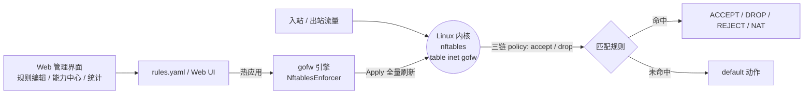

# 🛡️ gofw · Go 网络层防火墙

<p align="center">
  
  
  
  
  
</p>

> 基于 Go 实现的**内核级网络层防火墙**：规则匹配、DPI 深度检测、GeoIP、限速、NAT、VRRP 高可用，
> 并通过 `gofw start` 真·下发到内核 **nftables**（`table inet gofw`），配套 Web 管理界面即时可视化运维。

---

## 📑 目录

- [✨ 特性总览](#特性总览)
- [🚀 快速开始](#快速开始)
- [🏗️ 架构](#架构)
- [📦 核心功能](#核心功能)
- [📂 项目结构](#项目结构)
- [🔧 安装与构建](#安装与构建)
- [⚙️ 配置说明](#配置说明)
- [🖥️ 生产部署](#生产部署)
- [✅ 验证](#验证)
- [📚 文档](#文档)
- [📄 许可证](#许可证)
- [👤 作者](#作者)
- [🤝 贡献](#贡献)

---

## ✨ 特性总览

| 能力 | 说明 |
| :--- | :--- |
| 🎯 **多维规则匹配** | 网络层（IP / MAC）、传输层（端口 / 协议 / TCP 标志）、应用层（DPI）、连接状态、VLAN、时间段、流量方向 |
| 🔍 **DPI 深度包检测** | 识别 HTTP / TLS / SSH / DNS / MySQL / FTP / SMTP 等应用协议 |
| 🌍 **内置 GeoIP** | 内置 15 国 CIDR 库（1589 条），无需外部文件，按国家码匹配 |
| 🚦 **流量控制** | 令牌桶限速、按源 IP / 全局带宽限制、单源并发连接限制 |
| 🔀 **NAT 网络地址转换** | SNAT / DNAT / Masquerade |
| 🤝 **高可用 VRRP** | VRRPv2 主备选举、VIP 自动漂移，无权限时回退 TCP 探测 |
| 🖥️ **Web 管理界面** | 全字段规则编辑器、地址簿管理、能力中心、实时流量与连接统计 |

---

## 🚀 快速开始

```bash
# 构建（产物即真引擎）
go build -o gofw .

# 启动：真·下发内核 nftables，并开启 Web 管理界面
sudo ./gofw start -r rules.yaml --web :8080
```

> 💡 Web 管理由 `gofw start --web` 提供，它**本身就是真引擎**（改规则即时下发内核）。
> 另有 `cmd/uilaunch` 仅作本地内存预览、不下发内核，仅供开发调试，请勿用于生产。

打开浏览器访问 `http://<服务器>:8080` 即可使用管理面板。

---

## 🏗️ 架构



- **数据面**：流量经内核 `table inet gofw` 的 `input` / `output` / `forward` 三链，按规则 ACCEPT / DROP / NAT。
- **控制面**：`gofw start` 的 `NftablesEnforcer` 把 `rules.yaml` 编译后 `apply` 到内核，幂等全量刷新。
- **运维面**：Web UI 增删规则 → 引擎即时 `apply`，无需重启服务。

---

## 📦 核心功能

### 规则匹配
支持多维度包过滤：

| 维度 | 可匹配字段 |
| :--- | :--- |
| 网络层 | IP 地址、MAC 地址 |
| 传输层 | 端口、协议（TCP / UDP / ICMP） |
| 应用层 | TCP 标志位（SYN / ACK / FIN / RST / PSH / URG） |
| 连接状态 | NEW、ESTABLISHED、RELATED、INVALID |
| VLAN | VLAN ID |
| 时间 | 基于时间段的规则生效控制 |
| 方向 | 入站（In）、出站（Out）、双向（Any） |

### DPI 深度包检测
应用层协议识别，支持：

- **HTTP**：检测请求方法和 URI
- **TLS**：识别客户端 Hello 与服务器证书信息
- **SSH**：协议版本协商检测
- **DNS**：查询类型识别（A、AAAA、CNAME 等）
- **MySQL**：客户端认证与服务器问候包检测
- **FTP / SMTP** 等常用协议

### GeoIP 地理位置
内置 15 国 / 地区 CIDR 数据，无需外部文件：

> 中国、美国、日本、韩国、德国、英国、法国、俄罗斯、加拿大、澳大利亚、印度、巴西、新加坡、荷兰、中国香港、中国台湾

### 流量控制
- **速率限制**：基于令牌桶算法的请求速率控制
- **带宽限速**：按源 IP 或全局的流量带宽限制
- **并发连接限制**：限制单个源 IP 的并发连接数

### NAT 网络地址转换
- **SNAT**：源地址转换
- **DNAT**：目的地址转换
- **Masquerade**：动态地址伪装

### 高可用（VRRP）
- 实现 VRRPv2 协议（RFC 3768）
- 主备自动选举，优先级高者为主
- 支持 TCP 探测作为健康检查回退
- VIP 自动漂移

### Web UI 管理界面
- 🧩 **全字段规则编辑器**：MAC / VLAN / TCP flags / 连接状态 / 方向 / 时间段 / 限速三件套 / GeoIP / 地址组 / DPI / NAT 全字段可视化配置
- 📒 **地址簿管理**：IP 分组（ip_group）集中维护，规则内直接引用
- 🎛️ **能力中心**：`/api/system` 暴露引擎能力与运行模式
- 📊 **实时统计**：流量计数、连接状态、拦截日志实时面板
- 🔌 **即时下发**：规则增删改经 REST API 即时热应用到内核

---

## 📂 项目结构

```
gofw/
├── alert/          # 告警管理（Webhook、邮件通知）
├── capture/        # 数据包捕获（原始套接字）
├── cmd/verify/     # 功能验证测试
├── config/         # 配置加载（YAML 解析）
├── dpi/            # 深度包检测
├── enforce/        # 规则执行（nftables / 监控模式）
├── engine/         # 核心引擎（连接追踪、碎片重组）
├── geoip/          # GeoIP 地理位置库
├── ha/             # 高可用（VRRP 协议实现）
├── packet/         # 数据包解析
├── rules/          # 规则定义与匹配
├── webui/          # Web 管理界面（含 index.html 与 REST API）
├── main.go         # 主程序入口（真·规则下发引擎 gofw start）
├── rules.yaml      # 规则配置文件
└── deploy/         # 公网部署与运维产物（见 deploy/README.md）
```

---

## 🔧 安装与构建

### 前置要求
- Go 1.21+
- Linux 内核（推荐 5.x，需 nftables 支持）
- root 权限（或具备 `CAP_NET_ADMIN` 能力，用于真实下发内核规则）

### 构建

```bash
# 克隆项目
git clone https://gitee.com/nights-shadow/fhq.git
cd fhq

# 构建（产物即真引擎）
go build -o gofw .

# 或使用 Go 模块
go build -o gofw ./main.go
```

---

## ⚙️ 配置说明

### 规则配置（rules.yaml）

```yaml
rules:
  - action: drop
    src: 192.168.1.100
    dst: 10.0.0.1
    proto: tcp
    dport: 80
    direction: in
    state: new

  - action: accept
    src: 10.0.0.0/8
    proto: tcp
    dport: 443
    state: established

  - action: accept
    geoip: CN,US
    proto: tcp
    dport: 22

  - action: drop
    rate_limit:
      rate: 100
      burst: 50
      per_src: true

  - action: accept
    conn_limit:
      max: 100
      per_src: true

nat:
  - type: snat
    src: 192.168.0.0/16
    to_src: 203.0.113.1

  - type: dnat
    dst: 203.0.113.2
    dport: 8080
    to_dst: 192.168.1.100:80
```

### 完整启动命令

```bash
# 基本启动（真引擎，下发内核 nftables）
./gofw start -r rules.yaml

# 启动并开启 Web UI
./gofw start -r rules.yaml --web :8080

# 启用高可用（VRRP）
./gofw start -r rules.yaml --ha --ha-iface eth0 --ha-vip 192.168.1.254

# 监控模式（只记录、不下发内核）
./gofw start -r rules.yaml --monitor
```

> ⚠️ **严格模式提示**：`default: drop` 会**同时套用到 input / output / forward 三链**，
> 切之前务必把对外端口与必要出方向（DNS / NTP / 云厂商内部段）补进白名单，避免锁死服务器。
> 详见 [deploy/README.md](deploy/README.md)。

---

## 🖥️ 生产部署

公网部署、systemd 托管、EdgeOne + nginx 反代、严格模式切换与运维回退等，
请阅读专属运维文档：**[deploy/README.md](deploy/README.md)**。

---

## ✅ 验证

```bash
# 构建测试
go build ./...

# 代码检查
go vet ./...

# 单元测试（带竞态检测）
go test -race -count=1 ./...

# 功能验证
go run ./cmd/verify
```

---

## 📚 文档

- [功能说明文档（docs/FEATURES.md）](docs/FEATURES.md) — GeoIP 内置库、Web UI 增删改 API、VRRP 高可用的详细说明
- [公网部署与运维指南（deploy/README.md）](deploy/README.md) — 真引擎部署、安全加固、严格模式切换

---

## 📄 许可证

本项目采用 **MIT 许可证**，详见 [LICENSE](LICENSE) 文件。

---

## 👤 作者

- **署名**：暗夜铭少
- **邮箱**：azgq@foxmail.com

---

## 🤝 贡献

欢迎提交 Issue 和 Pull Request！
