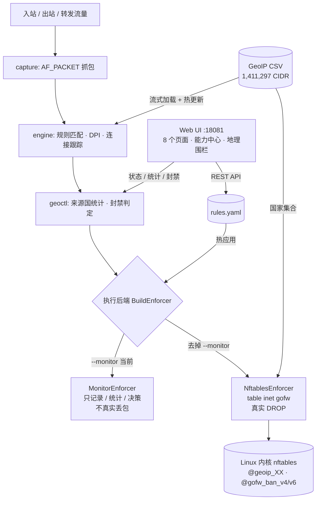

# 🛡️ gofw · 纯 Go 网络层防火墙

<p align="center">
  
  
  
  
  
  
  
</p>

> **一个二进制 = 引擎 + 规则 + Web 管理界面 + 图标**。纯 Go 实现，`CGO_ENABLED=0`，运行时零 Python、零外部依赖（仅 `gopkg.in/yaml.v3`）。
> 支持两种执行后端：**用户态监控（monitor）** 与 **内核 nftables 真实丢包**，由启动参数 `--monitor` 决定。

> 📌 **当前线上快照（2026-11-06 实测，对应提交 `a6c13be`）**
> `http://192.168.58.128:18081/` · systemd 托管开机自启 · **monitor 模式** · 规则 27 条 · 地理围栏未启用
> GeoIP 库 **1,411,297** 条（IPv4 597,286 / IPv6 814,011，250 个国家/地区，外部 DBIP CSV）
> 本地与线上二进制哈希一致，页面 / favicon 200，常驻内存约 330–410 MB，负载正常。
> ⚠️ **这一版跑的是监控挡位：只记录、统计、决策，不真实丢包。** 真实内核拦截的代码已就绪但未启用，见 [能力挡位](#-能力挡位速览)。

---

## 📑 目录

- [🎚️ 能力挡位速览](#-能力挡位速览)
- [🚦 两种运行挡位：monitor vs kernel](#-两种运行挡位monitor-vs-kernel)
- [✨ 功能清单](#-功能清单)
- [🏗️ 架构](#️-架构)
- [🌍 GeoIP 与地理围栏](#-geoip-与地理围栏)
- [🧑‍💻 小白四步：按国家放行 / 断网](#-小白四步按国家放行--断网)
- [🖥️ Web 管理界面与 API](#️-web-管理界面与-api)
- [📦 当前部署与回滚](#-当前部署与回滚)
- [🔧 构建、运行与参数](#-构建运行与参数)
- [✅ 验证与测试](#-验证与测试)
- [⚠️ 已知边界与未做事项](#️-已知边界与未做事项)
- [📚 文档索引](#-文档索引)
- [📄 许可证与数据来源](#-许可证与数据来源)

---

## 🎚️ 能力挡位速览

用户最关心的一句话：**现在到底有哪些功能，各做到什么程度？** 下面按真实代码与线上实测逐项标注，不夸大、不把"代码里有"写成"已经生效"。

**挡位定义**

| 挡位 | 含义 |
| :--- | :--- |
| 🟢 **L3 生产可用** | 已在 128 上稳定运行，页面 / API / 日志可验证 |
| 🟡 **L2 监控试跑** | 逻辑全跑（决策、统计、规则生成），但当前 `--monitor` 下不真实丢包 |
| 🔵 **L1 代码就绪 · 未启用** | 代码 + 测试 + 语法校验完成，线上没有切换，需人工确认后启用 |
| ⚪ **L0 未实现** | 明确没做，不臆造 |

| 能力 | 挡位 | 实现位置 / 验证方式 | 线上状态 |
| :--- | :---: | :--- | :--- |
| 多维规则匹配（IP/MAC/端口/协议/TCP flags/VLAN/时间段/方向/状态） | 🟢 L3 | `rules/`、`engine/`；Web 规则页 27 条 | 生效（用户态决策） |
| DPI 应用层协议识别（HTTP / TLS / SSH / DNS / MySQL / FTP / SMTP 等） | 🟢 L3 | `dpi/`；能力中心显示已加载 | 生效（用户态识别） |
| 连接跟踪、TCP 状态机、IP 分片重组 | 🟢 L3 | `engine/`；连接跟踪页 | 生效 |
| AF_PACKET 抓包、网关模式 | 🟢 L3 | `capture/`、`--gateway` | 可用，未开启网关模式 |
| 限速 / 带宽 / 并发连接限制、NAT、VRRP 高可用 | 🟢 L3 | `enforce/`、`ha/`；有单元测试 | 编译与规则可用，线上未启用这些规则 |
| Web 管理界面（8 个页面）+ 盾牌 favicon + 能力中心 | 🟢 L3 | `webui/`，`//go:embed` 编入二进制 | 200 可访问，能力中心有真实数据 |
| 规则 / 地址簿增删改 + YAML 持久化 + 注释保留 | 🟢 L3 | `webui/webui.go`、`config/comments.go` | 生效，注释锚点迁移已测 |
| 告警（Webhook / SMTP） | 🟢 L3 | `alert/`；`--alert /opt/gofw/alert.yaml` | 已配置 |
| **全球 GeoIP 库**（141 万 CIDR、v4 + v6、250 国家/地区） | 🟢 L3 | `geoip/`；流式加载 + 最长前缀二分索引 | `/api/geofence` 返回 `loaded:true` |
| GeoIP 定时热加载 + 手动重载 + 统计缓存 | 🟢 L3 | `--geoip-reload-interval 60`、`/api/geoip/reload` | 生效，内存无增长 |
| 来源国实时排行、决策统计、拦截流 | 🟡 L2 | `geoctl/tracker.go`、`/api/geoip/stats` | 数据真实，但"丢弃"=引擎判定，非内核真丢 |
| 阈值自动封禁、手动封禁 / 解封、安全网段豁免 | 🟡 L2 | `geoctl/`、`/api/bans` | 判定生效；管理机 / 回环 / LAN 三层豁免已实测 |
| 一键地理围栏（黑名单 / 白名单 / 端口 / 清空） | 🟡 L2 | `webui/geofence.go`，护栏强制前置 | 规则可生成、顺序可核对、可一键清空；**未真实断网** |
| 中文国家选择 + 基于真实流量的策略预演 | 🟢 L3 | `webui/index.html`（`Intl.DisplayNames` + 来源国统计） | 页面可用，Ctrl+F5 后可见 |
| **nftables 内核真实丢包**（`table inet gofw`） | 🔵 L1 | `enforce/`，`nft -c -f` 语法校验通过、规则顺序测试通过 | **未启用**，线上仍是 `--monitor` |
| GeoIP v4/v6 命名集合 + 动态封禁集下发内核 | 🔵 L1 | `enforce/enforce.go`（`ip6 saddr`、`gofw_ban_v6`） | 代码就绪，未随 monitor 下发 |
| 地理围栏真实封锁（国家级断网） | 🔵 L1 | 需去掉 `--monitor` 后重启 | 未启用 |
| eBPF / XDP 数据面、分布式集群同步、多机策略下发 | ⚪ L0 | — | 未做 |

> 一句话总结当前级别：**L3「看得清、配得动、数据真实」+ L2「决策与围栏全程试跑」+ L1「真丢包能力备好但没开」**。
> 这是刻意保留的安全档：内网低配 VM 上，先把策略在监控里试跑、看清影响、确认护栏没锁住自己，再切内核。

---

## 🚦 两种运行挡位：monitor vs kernel

| 对比项 | 🟡 monitor（**当前线上**） | 🟢 nftables kernel（去掉 `--monitor`） |
| :--- | :--- | :--- |
| 抓包 / 规则匹配 / 决策 | ✅ 全跑 | ✅ 全跑 |
| 统计、日志、来源国排行、拦截流 | ✅ 真实 | ✅ 真实 |
| 地理围栏规则生成、护栏、清空 | ✅ 可用 | ✅ 可用 |
| 是否真的丢包 | ❌ **不丢包，流量照常通过** | ✅ 内核 `table inet gofw` 真实 DROP |
| 自动封禁是否生效 | 记录判定、写入封禁表 | 额外下发 `@gofw_ban_v4/v6` 集合 |
| Web 顶部横幅 | 黄色「旁路监控模式」 | 绿色「内核生效模式（nftables）」 |
| 风险 | 无锁死风险 | 护栏缺失会锁死 SSH / Web |

> 页面横幅由 `/api/geofence` 的 `mode` 字段驱动，**按真实 enforcer 类型显示**，不会把监控冒充成内核模式。

---

## ✨ 功能清单

| 模块 | 能力 | 说明 |
| :--- | :--- | :--- |
| `rules/` `engine/` | 规则引擎 | `accept / drop / reject / log`，多字段组合匹配，连接状态与时间段的匹配，方向规则已修复（用户态不再跳过 `direction:in/out`） |
| `dpi/` | 深度包检测 | HTTP / TLS / SSH / DNS / MySQL / FTP / SMTP 等协议识别 |
| `capture/` | 抓包 | `AF_PACKET` raw socket，单网卡 / 多网卡，混杂模式 |
| `geoip/` | GeoIP | 流式 CSV 加载、原子替换、v4/v6 分族最长前缀索引、国家/统计预计算、城市与 ASN 扩展列可选、`LookupFull` |
| `geoctl/` | 地理围栏控制 | 来源国计数、阈值封禁、手动封禁、版本变化触发重下发、三层安全网段豁免 |
| `enforce/` | 双后端 | `MonitorEnforcer`（只记录）与 `NftablesEnforcer`（编译 limit / ct count / meter / TCP flags / GeoIP set / ban set） |
| `webui/` | Web 管理 | 单页应用 + REST API，`//go:embed index.html` 与 `favicon.ico` 编入二进制 |
| `config/` | 配置 | YAML 读写、注释锚点迁移（Save 不再抹掉手工分段注释）、并发安全 |
| `alert/` `ha/` | 告警 / 高可用 | Webhook（generic/slack/dingtalk）与 SMTP；VRRPv2 主备选举与 VIP 漂移，无权限回退 TCP 探测 |

---

## 🏗️ 架构



- **控制面**：Web 改规则 → `config` 持久化 → `apply` 互斥锁串行化 → 后端重编译；库文件 mtime 变化触发版本变化重下发。
- **数据面**：monitor 下走用户态决策；kernel 下由 nftables 集合匹配真实丢包。
- **运维面**：全部逻辑在一个 Go 进程里，`systemd` 托管，**没有 Python 助手、没有代理脚本**。

---

## 🌍 GeoIP 与地理围栏

### 真实库，不再是"代表性网段"

旧文档写的是内置 16 国 / 1589 条精简库，那已经过时。当前线上加载的是**外部 DBIP Country Lite 全量库**（`rules.yaml.geoip`）：

| 指标 | 数值 |
| :--- | ---: |
| 总 CIDR | **1,411,297** |
| IPv4 段 | 597,286 |
| IPv6 段 | **814,011** |
| 国家 / 地区 | 250 |
| 加载方式 | 流式 `csv.Reader` + 原子替换，启动约几十秒 |
| 查询 | 按 v4/v6 + 前缀长度分族二分，**最长前缀匹配** |
| 热加载 | `--geoip-reload-interval 60`（mtime 检测）+ `POST /api/geoip/reload` |

IPv6 段由起止区间拆分为最少 CIDR 并做同国相邻合并，抽样 244 万点校验零失配。数据来源 **DBIP / CC BY 4.0**，精度为国家/地区级，不能当司法级归属证据；库文件旁的 `rules.yaml.geoip.LICENSE` 记录署名与限制。

### 一键地理围栏

| 预设 | 语义 | 典型用途 |
| :--- | :--- | :--- |
| `blacklist` | 只拦选中国家，其它照常 | 阻断某国访问 |
| `whitelist` | 只放选中国家，其余全断 | 国家级地理围栏 / 仅本国访问 |
| `ports` | 只在指定端口上限制 | 只保护 SSH / RDP |
| `clear` | 只删 `[gofw-*]` 托管规则 | 一键回到原规则集 |

**防锁死护栏（不可关闭，强制置顶）**：已建立连接、loopback、管理端口 `22,888,18706,18081`、LAN 网段。规则顺序固定为 `护栏 → 围栏 → 保留的业务规则`，避免业务里的 `accept 80,443` 抢先命中；清空操作只移除托管标记规则，不碰手工规则。顺序由 `webui/geofence_test.go` 锁定。

---

## 🧑‍💻 小白四步：按国家放行 / 断网

1. **选国家**：进「地理围栏」页，从中文下拉里选（中国 / 美国 / 俄罗斯…），或点常用国家按钮，不用记 `RU` / `US`。下拉里每个国家都标了网段数。
2. **看预演**：页面用本次启动以来的**真实来源国流量**算出：选中这些国家有多少包、其它来源有多少包，并写明黑名单拦谁、白名单拦谁。
3. **应用**：点「禁止这些国家访问」或「只允许这些国家访问」，规则列表里可逐条核对护栏是否排在最前；不满意点「清空，恢复原状」。
4. **真正断网**：去掉启动参数 `--monitor` 并重启，切到 nftables 内核后端。横幅由黄变绿，此时规则才会真实丢包。

> 前三步在 monitor 下就能做、能看到结果；第 4 步是唯一会改变真实流量的动作，**必须先确认护栏放行了管理通道与内网**，否则可能把自己锁在服务器外面。

---

## 🖥️ Web 管理界面与 API

**页面**：概览、规则管理、地址簿、实时拦截、连接跟踪、能力中心、地理围栏、配置源。盾牌 favicon 与页面一起 `//go:embed` 编入二进制，无外部静态文件。

| Method | Path | 说明 |
| :--- | :--- | :--- |
| GET | `/api/stats` `/api/events` | 实时统计 / 事件流 |
| GET/POST | `/api/rules`、`/api/rules/{index}` | 规则增删改查 |
| GET/POST | `/api/ipgroups`、`/api/ipgroups/{name}` | 地址簿 |
| GET | `/api/conns` `/api/config` `/api/system` | 连接表 / 配置 / 能力中心 |
| POST | `/api/reload` | 热重载规则 |
| GET | `/api/geofence` | 库统计、v4/v6、护栏与围栏规则、`mode` |
| POST | `/api/geofence/apply` | 应用黑名单 / 白名单 / 端口预设 |
| POST | `/api/geofence/clear` | 清空托管规则 |
| GET | `/api/geoip/countries` `/api/geoip/stats` | 国家列表 / 来源国排行与封禁配置 |
| POST | `/api/geoip/reload` | 手动热加载 GeoIP 库 |
| GET/POST/DELETE | `/api/bans`、`/api/bans/{ip}` | 封禁列表 / 手动封禁 / 解封 |
| GET | `/favicon.ico` | 内嵌盾牌图标 |

> 未设置密码时 API 放行；设置密码后 `/api/*` 走会话 cookie 校验。能力中心按 `/api/system` 与规则注释真实推导，不用占位假数据。

---

## 📦 当前部署与回滚

```ini
# /etc/systemd/system/gofw.service（线上 ExecStart，保持 monitor）
ExecStart=/opt/gofw/gofw start -r /opt/gofw/rules.yaml -i ens32 --web :18081 --monitor \
  --stats-interval 15 --log-file /opt/gofw/gofw.log --alert /opt/gofw/alert.yaml \
  --geoip-reload-interval 60 --auto-ban --ban-threshold 30 --ban-window 10 --ban-ttl 300 \
  --ban-safe-cidr 192.168.58.0/24,127.0.0.0/8,10.0.0.0/8
```

- 访问：`http://192.168.58.128:18081/`（**不是 80 / 8981 / 8080**）。
- 产物：`GOOS=linux GOARCH=amd64 CGO_ENABLED=0 go build -o gofw.linux .`，单文件约 11 MB，scp 覆盖 `/opt/gofw/gofw` 后重启即可。
- 备份：`gofw.bak.*`、`gofw.service.bak.*`、`rules.yaml.geoip.bak.*`；规则文件 `rules.yaml` 保持原始 27 条。
- 回滚：代码回退到 `dba12b2`（本次增强前），或用备份二进制替换后 `systemctl restart gofw`。

---

## 🔧 构建、运行与参数

```bash
# Linux 目标（推荐，仓库内 capture/ha 含 Linux 专用 syscall）
GOOS=linux GOARCH=amd64 CGO_ENABLED=0 GOFLAGS=-mod=mod go build -o gofw.linux .

# 启动：监控挡位（当前线上）
sudo ./gofw.linux start -r rules.yaml -i ens32 --web :18081 --monitor

# 启动：内核真实拦截（需先确认护栏）
sudo ./gofw.linux start -r rules.yaml -i ens32 --web :18081
```

| 参数 | 默认 | 说明 |
| :--- | :--- | :--- |
| `-r, --rules` | 必填 | 规则文件 |
| `-i, --interface` | `eth0` | 监听网卡 |
| `--monitor` | `false` | **只记录决策 / 统计 / 日志，不真实丢包** |
| `--web` | — | Web 监听地址，如 `:18081` |
| `--workers` | CPU 核数 | 工作线程数 |
| `--stats-interval` | `0` | 统计输出间隔（秒） |
| `--ctl-sock` | `/tmp/gofw.sock` | 控制套接字 |
| `--gateway` | `false` | 网关模式（IP 转发 + 多网卡抓包） |
| `--ha` / `--alert` / `--log-file` | — | 高可用配置 / 告警配置 / 日志文件 |
| `--geoip-reload-interval` | `0`（关闭） | GeoIP 库 mtime 热加载检查间隔（秒） |
| `--auto-ban` | `false` | 启用阈值自动封禁 |
| `--ban-threshold` | `20` | 窗口内 DROP 次数阈值 |
| `--ban-window` | `10` | 统计窗口（秒） |
| `--ban-ttl` | `300` | 封禁时长（秒） |
| `--ban-safe-cidr` | 空 | 永不封禁的额外网段（逗号分隔） |

子命令：`start`、`rules list|stats|add|del`、`conns list`、`reload`、`test`（详见 `main.go`）。

---

## ✅ 验证与测试

```bash
# Linux 全量编译（Windows 本机请带 GOOS=linux，capture/ha 是 Linux 专用代码）
GOOS=linux GOARCH=amd64 CGO_ENABLED=0 go build ./...

# 本次增强相关包测试（跨平台可跑）
go test ./config ./enforce ./engine ./geoctl ./geoip ./webui

# 页面 JS 语法（抽取 <script> 内容后校验，临时文件随即删除）
node -e "const fs=require('fs');const h=fs.readFileSync('webui/index.html','utf8');const m=[...h.matchAll(/<script[^>]*>([\s\S]*?)<\/script>/g)];fs.writeFileSync('ui-check.js',m.map(x=>x[1]).join('\n'))" && node --check ui-check.js && rm ui-check.js
```

新增 6 个回归测试：注释锚点迁移、GeoIP 最长前缀 / v4 / v6 / 热加载、自动封禁安全网段豁免、围栏规则顺序、nftables IPv6 集合。线上已验证：白名单 CN 生成 32 条规则且护栏置顶、Web/SSH 可达，`clear` 回 27 条无残留，手动热加载与公网 IP 封禁/解封正常，`nft -c -f` 语法校验通过。

---

## ⚠️ 已知边界与未做事项

- **当前线上是 monitor**：页面上的"丢弃 / 拦截"是引擎决策计数，**不等于内核真丢包**；真实断网必须去掉 `--monitor` 并确认护栏。
- **内核后端未做线上实切**：语法校验、规则顺序测试通过，但真实下发到生产流量尚未验证，属于 L1。
- **GeoIP 精度**：国家/地区级，存在 `??`（无归属，含内网）与边界误差；IPv6 由区间拆分合并而来，非运营商原始宣告。
- **DPI 在用户态**：用于识别与统计，不是内核线速过滤。
- **未实现**：eBPF/XDP 数据面、集群策略同步、基于城市/ASN 的自动策略、Web 认证默认强制开启。

---

## 📚 文档索引

- [功能说明（docs/FEATURES.md）](docs/FEATURES.md) — GeoIP 库、Web API、地理围栏、自动封禁、VRRP 细节
- [部署与运维（deploy/README.md）](deploy/README.md) — systemd、严格模式、真下发流程（注意线上目前是 monitor）

---

## 📄 许可证与数据来源

- 代码：**MIT**，见 [LICENSE](LICENSE)。
- GeoIP 数据：DBIP Country Lite，**CC BY 4.0**，需保留署名；国家/地区级精度，详见库文件旁 `rules.yaml.geoip.LICENSE`。

---

## 👤 作者

- **署名**：暗夜铭少 · **邮箱**：azgq@foxmail.com
- 仓库：https://gitee.com/nights-shadow/gofw.git

欢迎提交 Issue 和 Pull Request。
